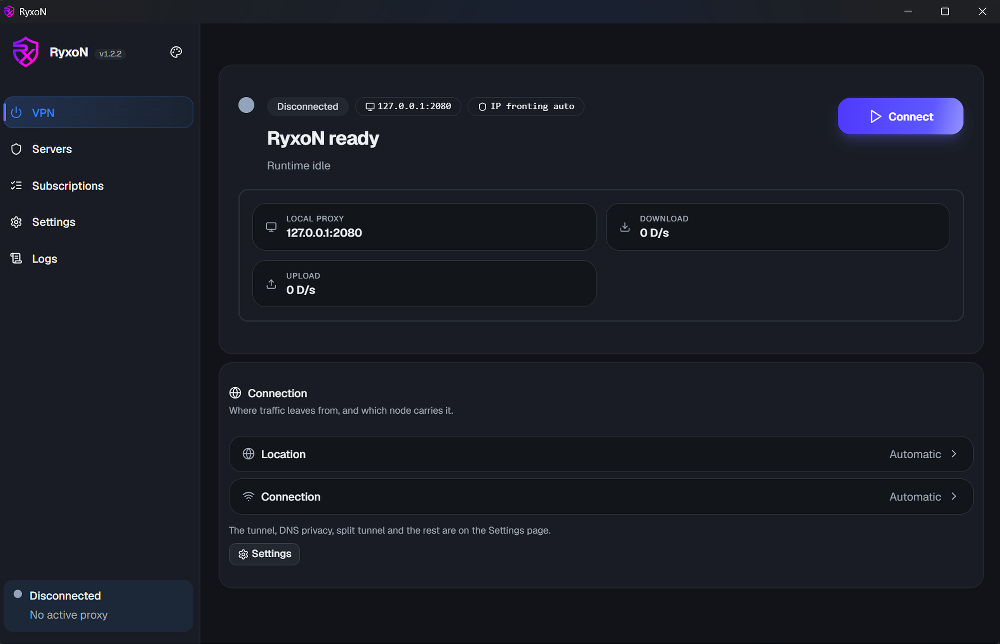

<div align="center">


# RyxoN

**Your subscriptions, your servers, one desktop app.**

*Connect, compare servers, and see where your traffic leaves the network — on Windows and Linux.*

<br />

[](#download)
[](#download)
[](#download)
[](https://t.me/RyxoStudio)

</div>

---

## Overview

RyxoN is a desktop client for the subscriptions and proxy configurations you already have. Add your sources, compare the servers, and connect through the embedded **mihomo** engine. There is no separate core to install and no account to create for using your own configs.

Once connected, the dashboard shows the exit IP, country, network owner and traffic counters. The country is checked through the connection, rather than taken only from the flag in a server's name. Open the exit details to see the connected node's live latency.

Automatic selection can recover when a server stops carrying traffic. If you have chosen a specific node, RyxoN keeps that choice and tells you when it needs attention instead of moving you somewhere else.

<div align="center">

| | |
|:--|:--|
| **Engine** | Embedded mihomo (Clash.Meta), with FlClash integration |
| **Desktop shell** | Wails v2 · Go backend |
| **Interface** | React 18 · TypeScript · Vite · Tailwind CSS v4 · shadcn/ui |
| **Languages** | English and Persian, with right-to-left layout |
| **Platforms** | Windows AMD64 · Linux AMD64 / ARM64 |

</div>

---

## Screenshots

<p align="center">
  
</p>

---

## Contents

- [Features](#features)
- [Supported protocols](#supported-protocols)
- [Download](#download)
- [Installation](#installation)
- [Verifying downloads](#verifying-downloads)
- [Quick start](#quick-start)
- [Connection modes](#connection-modes)
- [How it works](#how-it-works)
- [Privacy](#privacy)
- [Troubleshooting](#troubleshooting)

---

## Features

### Connectivity

- **Subscriptions and manual configs together.** Keep provider subscriptions separate from the profiles you add yourself, and switch sources from the Servers page.
- **Several import formats.** Read supported share links, Clash/mihomo YAML, sing-box JSON, Xray JSON and WireGuard / AmneziaWG configuration text.
- **Country and protocol filters.** Narrow your choices, let Automatic find a working connection, or pin a particular node.
- **System proxy, proxy only or TUN.** Use the mode that fits your applications, with a configurable local HTTP/SOCKS port.
- **Connection chaining.** Choose an optional second hop for supported configurations and transport combinations.

### Measurements

- **Exit information through the connection.** Check the public exit IP and country, with a best-effort lookup of the network owner.
- **Multi-sample latency tests.** Bulk delay tests discard the warm-up request and report the median of three samples, together with their spread.
- **A live latency readout.** Opening the connected node's details starts a fresh measurement and refreshes it while the panel stays open.
- **Separate reachability, delay and speed tests.** A reachable port, a working proxied request and a fast download answer different questions; the app keeps them separate.
- **Engine-based delay testing.** Test the configured proxy path, including protocols that a simple TCP connection to the server cannot validate.

### Reliability

- **Connection checks before success.** The app checks that a request can pass through the proxy before reporting the connection as established.
- **Ongoing health checks.** A watcher checks the session on a 20-second interval. Repeated failures trigger recovery in Automatic mode; pinned nodes remain your choice.
- **Tray support.** On systems where a tray icon is available, closing the window can leave the app running in the background.
- **Update checks.** See release information in the app. The Windows update flow includes downloading and installing an update on restart; Linux packages are also available for manual installation.

### Interface and settings

- **A server workbench.** Search, sort, select, test, export and delete server entries from one page.
- **English and Persian.** The Persian interface includes right-to-left layout, with light, dark and system themes.
- **Animated theme changes.** Smooth transitions where the embedded webview supports them, with a fallback on other systems.
- **Split routing.** Process-based bypass and VPN-only rules, subject to the platform's process detection.
- **DNS controls.** Automatic DNS, DNS over HTTPS and DNS over TLS options.
- **Optional ad blocking.** Engine rules reject known advertising and tracker domains.

---

## Supported protocols

The table lists the protocols handled by RyxoN's profile and subscription paths. Import coverage varies by format: a protocol supported in a subscription is not necessarily available in the manual editor.

| Scheme or format | Protocol | Supported options and notes |
|:--|:--|:--|
| `vless://` | **VLESS** | TCP, WebSocket, gRPC, HTTP/2, HTTPUpgrade and XHTTP; TLS, Reality and ECH options where supported. |
| `vmess://` | **VMess** | Encoded and URL-style links, with common TCP, WebSocket, gRPC, HTTP/2 and TLS settings. |
| `trojan://` | **Trojan** | TLS, common transport options and ECH handling in the link parser. |
| `ss://`, `shadowsocks://` | **Shadowsocks** | Cipher/password settings and supported SIP003 plugins. |
| `ssr://` | **ShadowsocksR** | Subscription link parsing, including protocol and obfuscation parameters. |
| `hysteria://` | **Hysteria v1** | Subscription parsing with v1 authentication, bandwidth and obfuscation options. See the manual-import note below. |
| `hysteria2://`, `hy2://` | **Hysteria2** | QUIC, supported port-hopping settings and Salamander obfuscation. |
| `tuic://` | **TUIC** | Version-specific credentials, congestion control and UDP relay options. |
| `masque://` | **MASQUE** | HTTP/2 and HTTP/3 transport, local addresses and supported tunnel settings. |
| `.conf`, `wireguard://`, `wg://` | **WireGuard** | Keys, interface addresses, endpoint and supported peer settings. |
| `.conf`, `amneziawg://`, `awg://`, supported `vpn://` payloads | **AmneziaWG** | Numeric obfuscation options, signature/timing fields and header ranges supported by the parser. |
| `ssh://` | **SSH** | Subscription link parsing with password or private-key options. |
| `anytls://` | **AnyTLS** | TLS, credentials and supported session settings. |
| `socks://`, `socks5://` | **SOCKS** | Upstream proxy profiles. |
| `http-proxy://`, `https-proxy://` | **HTTP / HTTPS proxy** | Upstream proxy profiles; the explicit schemes avoid confusion with subscription URLs. |

**Shadowsocks plugins:** `obfs` · `v2ray-plugin` · `gost-plugin` · `shadow-tls` · `restls` · `jls` · `kcptun`.

**Subscription formats:** share-link lists and supported encoded bodies, Clash/mihomo YAML, sing-box JSON, Xray JSON, and WireGuard / AmneziaWG INI text. JSON imports translate supported fields; they do not reproduce every feature of another core.

> **Manual-import coverage:** SSR, SSH and Hysteria v1 are supported by the subscription link parser. They do not yet have equivalent manual-profile support. In particular, the manual importer currently treats `hysteria://` as a Hysteria2 profile, so use a subscription source for v1.

---

## Download

<div align="center">

### Release build — `v1.2.2`

[](https://github.com/itzsepanta/RyxoN/releases)

</div>

The files attached to a GitHub release are the authoritative download list. The current 1.2.2 build set contains the following packages; a local build may be prepared before it appears on GitHub.

### Windows 10 / 11

| Asset | Use it when |
|:--|:--|
| `RyxoN.exe` | You use 64-bit Windows on an Intel or AMD processor. Download and run; no application installer is needed. |

### Linux

| Asset | Architecture | Use it when |
|:--|:--|:--|
| `RyxoN-Desktop-1.2.2-linux-amd64.deb` | Intel / AMD x86-64 | You use a Debian-based distribution with compatible runtime libraries. |
| `RyxoN-Desktop-1.2.2-linux-arm64.deb` | 64-bit ARM | You need the ARM64 Debian package. |
| `RyxoN-Desktop-1.2.2-linux-amd64.rpm` | Intel / AMD x86-64 | You use an RPM-based distribution with compatible runtime libraries. |
| `RyxoN-Desktop-1.2.2-linux-arm64.rpm` | 64-bit ARM | You need the ARM64 RPM package. |
| `RyxoN-Desktop-1.2.2-linux-amd64.zip` | Intel / AMD x86-64 | You prefer to extract and run the application yourself. |
| `RyxoN-Desktop-1.2.2-linux-arm64.zip` | 64-bit ARM | You need the extracted ARM64 binary. |

`amd64` is the architecture name for both Intel and AMD x86-64 CPUs. On Linux, `uname -m` reports `x86_64` for AMD64 or `aarch64` for ARM64.

**Packaging note:** older releases included AppImage and `-webkit41` variants. Neither is part of this 1.2.2 build set. The current native Linux builds target **GTK 3 and WebKitGTK 4.0**; a newer distribution providing only WebKitGTK 4.1 needs a compatible build. A ZIP still needs the system runtime libraries.

---

## Installation

### Windows

1. Download `RyxoN.exe` from [Releases](https://github.com/itzsepanta/RyxoN/releases).
2. Place it in a folder you can write to and run it.
3. If prompted about a missing WebView2 runtime, install it and launch again.

If Windows shows a SmartScreen warning, verify where the file came from and compare its checksum before deciding to run it. The executable being portable does not mean its settings live beside it; those are stored in your user profile.

### Debian, Ubuntu and Mint

For Intel / AMD 64-bit machines:

```bash
sudo apt install ./RyxoN-Desktop-1.2.2-linux-amd64.deb
```

Use `linux-arm64.deb` for ARM64. Launch the app from your application menu after installation.

### Fedora and other RPM-based systems

On a system using DNF:

```bash
sudo dnf install ./RyxoN-Desktop-1.2.2-linux-amd64.rpm
```

Use the ARM64 package on ARM64 systems. Other RPM package managers have their own installation commands.

### Extracted Linux build

Unpack the ZIP for your architecture, open a terminal in the extracted folder, then run:

```bash
chmod +x ./RyxoN
./RyxoN
```

Run the graphical application as your normal user. Allow the app's elevation prompt when TUN needs permission.

> **Ubuntu 26.04 and other recent distributions:** check the runtime dependency before installation. WebKitGTK 4.0 and 4.1 are not interchangeable. Do not force-install a package with unresolved dependencies or symlink one version's library name to the other. A successful build on another distribution does not establish compatibility with yours.

### Uninstall

Disconnect and quit RyxoN first, so the app can clean up its active connection settings.

- **Windows:** delete `RyxoN.exe`.
- **Debian-based installation:** remove the installed package with `sudo apt remove ryxon-desktop`.
- **RPM installation:** remove the installed package using your distribution's package manager, for example `sudo dnf remove ryxon-desktop`.
- **Linux ZIP:** delete the extracted application folder.

Saved data is kept separately:

| System | Default data directory |
|:--|:--|
| Windows | `%APPDATA%\RyxoN` |
| Linux | `$XDG_CONFIG_HOME/RyxoN`, usually `~/.config/RyxoN` |

Remove that directory only if you also want to delete your saved settings, subscriptions and profiles. Back it up first if you want to keep them.

---

## Verifying downloads

Download `SHA256SUMS.txt` from the **same release** as your application file.

```bash
# Linux — run in the download directory
sha256sum --ignore-missing -c SHA256SUMS.txt
```

```powershell
# Windows
Get-FileHash .\RyxoN.exe -Algorithm SHA256
```

On Windows, compare the output with the matching line in `SHA256SUMS.txt`. If the checksum differs, download the file again. Checksums help detect damaged or changed files; they do not validate a proxy provider or server configuration.

---

## Quick start

1. **Launch RyxoN** after installing the matching build.
2. **Add a subscription** in Subscriptions, or open **Servers → Add configs** to paste a supported link or configuration text.
3. **Choose a source** in Servers. Manually added profiles appear under **Manual**.
4. **Test the nodes.** Compare latency results before choosing a server, or leave the dashboard on Automatic.
5. **Choose a connection mode** in Settings, then connect.
6. **Check the result.** Read the connection status and exit details on the dashboard.

Keep the original link when importing a configuration. Fields such as MASQUE's `transport=h2` or Hysteria2's `obfs=salamander` and `obfs-password` can be essential. If a provider omits a required credential, the app cannot reconstruct it.

### Using the Servers page

Search and filters change which rows are displayed. In the current build, the header checkbox selects the source's whole loaded list, including rows outside a display filter. With no selection, Test covers that source; with a selection, it tests the selected rows. The multi-list test walks the available sources in turn.

Deleting a Manual profile removes the saved configuration. Deleting a subscription row excludes it locally without editing the provider's original subscription. There is no Restore deleted button.

A low ping is useful, but it does not guarantee high download speed. Reachability only checks whether an endpoint answers a TCP connection; delay tests check requests through the engine, and speed tests consume bandwidth to measure a transfer. Each result describes that test at that time.

---

## Connection modes

| Mode | What it does |
|:--|:--|
| **System proxy** | Points the operating system's proxy settings at RyxoN. Applications must honor those settings to use it. |
| **Proxy only** | Starts a local HTTP/SOCKS listener. You configure each application to use it yourself. |
| **Tunnel (TUN)** | Creates a virtual network adapter and routes tunnel traffic through it. Requires elevated permissions. |

The default mixed HTTP/SOCKS port is **2080**. If it has been changed, use the endpoint shown in the app. TUN includes IPv6 and DNS handling, but actual traffic coverage also depends on permissions, split rules and other networking software on the machine.

Settings also include DNS privacy options, process-based split routing, an optional second hop, TLS integrity checks and WireGuard-related Amnezia noise. Some changes take effect on the next connection. LAN sharing exposes the listener to other devices, so enable it only on a trusted network.

The Network Optimizer option has been removed. The current kill-switch control is disabled; do not rely on it to block traffic after a disconnect.

---

## How it works

```text
┌──────────────────────────────┐        ┌──────────────────────────────┐
│  React interface             │        │  Go backend                  │
│  TypeScript · Tailwind v4     │◄──────►│  Wails bindings and events   │
└──────────────────────────────┘        └──────────────┬───────────────┘
                                                      │ local IPC
                                       ┌──────────────▼───────────────┐
                                       │  Embedded mihomo engine      │
                                       │  Proxies · rules · TUN        │
                                       └──────────────────────────────┘
```

The Go backend starts and manages the engine as a child process. It builds the runtime configuration, runs health checks and measurements, and sends updates to the interface through Wails events.

The control channel uses framed JSON over a named pipe on Windows or a local socket on Linux. RyxoN ships a mihomo build with the FlClash integration needed for that channel. Replacing it with a stock mihomo executable is not a supported upgrade path.

This public repository contains downloads and documentation. The application source is not published here.

---

## Privacy

RyxoN does not require a RyxoN account to use your own configurations, and it has no telemetry, analytics or automatic crash-reporting feature. Profiles, subscriptions and settings are stored in your local user data directory.

The app still needs network requests for its normal features:

| Feature | What is contacted |
|:--|:--|
| **Subscription loading and refresh** | Your subscription provider. Cached lists and background loading may be used. |
| **Connection, latency and speed checks** | The configured test endpoints, through the relevant proxy test path. |
| **Exit-country check** | Cloudflare's trace endpoint through the proxy. |
| **Network-owner lookup** | IP information services, including IPinfo and an IP-API fallback. |
| **Updates** | GitHub release services. |

Your proxy provider and destination services have their own privacy practices. RyxoN cannot make an untrusted server safe, and a profile that disables certificate verification weakens connection authentication.

Configuration files may contain passwords, subscription tokens and private keys. Keep backups private and remove credentials before sharing logs or screenshots. Connection modes can change system proxy or routing settings; local storage does not mean the app never interacts with the operating system.

---

## Troubleshooting

<details>
<summary><strong>A config imports, but it does not connect</strong></summary>

Check the original configuration on the same network in another client, then compare the transport, TLS/SNI, credentials and obfuscation settings. Run a delay test and read the diagnostic message. A successful import means the format was recognized, not that the server was authenticated or reachable.

For Hysteria2 with Salamander, both the obfuscation name and password must be present. For MASQUE, preserve the intended HTTP/2 or HTTP/3 transport and the local addresses. Keep the full original link for comparison, but redact it before posting publicly.

</details>

<details>
<summary><strong>Linux reports missing GTK or WebKitGTK libraries</strong></summary>

Use a package built for the runtime your distribution provides. ZIP downloads also depend on the system libraries.

For an extracted binary, check missing dependencies with:

```bash
ldd ./RyxoN | grep 'not found'
```

Include the missing library names and the exact package filename in a report. Do not work around a WebKitGTK 4.0/4.1 mismatch by renaming or symlinking libraries.

</details>

<details>
<summary><strong>The Linux window is blank or fails on Wayland / AMD</strong></summary>

The Linux app sets WebKit renderer compatibility defaults before opening the window. To try them explicitly with an extracted build:

```bash
WEBKIT_DISABLE_DMABUF_RENDERER=1 WEBKIT_DISABLE_COMPOSITING_MODE=1 ./RyxoN
```

If XWayland is installed, compare with the X11 backend:

```bash
GDK_BACKEND=x11 ./RyxoN
```

These are troubleshooting options, not a guarantee for every graphics driver. Report your distribution, session type, GPU and driver if the problem continues.

</details>

<details>
<summary><strong>An older AppImage reports GLib / GIO undefined symbols</strong></summary>

Errors mentioning `libdconfsettings.so`, `libgvfscommon.so`, `g_assertion_message_cmpint` or `g_task_set_static_name` can come from bundled GLib libraries loading incompatible host GIO modules. Do not assume those errors are harmless if the app does not open.

A native package matched to your system can avoid that bundling mismatch, but it still needs the right WebKitGTK runtime. The `JSC_SIGNAL_FOR_GC` message alone does not identify the cause of a startup failure.

</details>

<details>
<summary><strong>The engine did not connect to the app</strong></summary>

The backend did not establish its control channel with the engine. Restart RyxoN, confirm you are using an intact official release, and check whether security software blocked or quarantined a component. Do not replace the embedded core with a stock executable. If the error persists, include the app version and diagnostic text in a report.

</details>

---

<div align="center">

### Using RyxoN? A star helps others find it.

**Powered by [RyxoStudio](https://ryxo.ir)**

<sub>© 2026 RyxoN · All rights reserved. Third-party components remain under their respective licenses.</sub>

</div>
